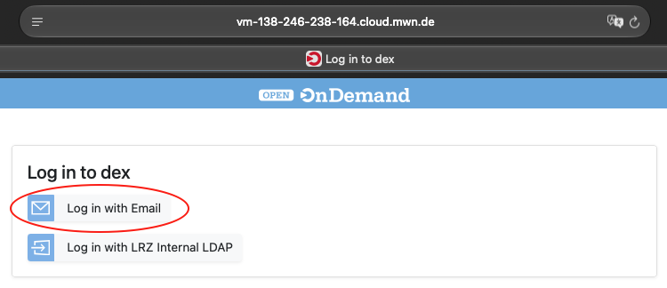
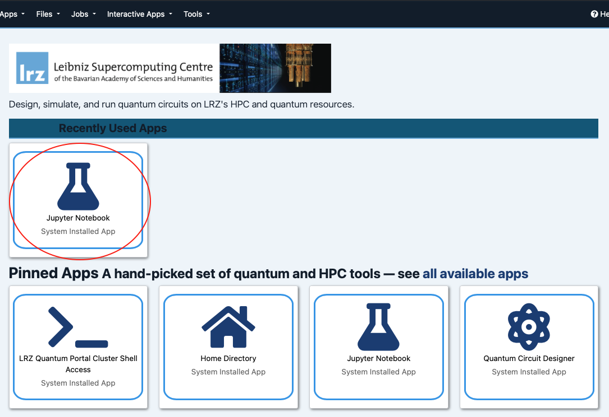
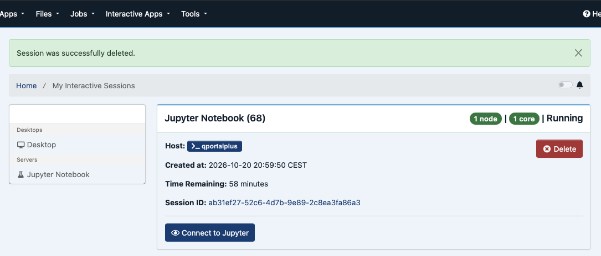
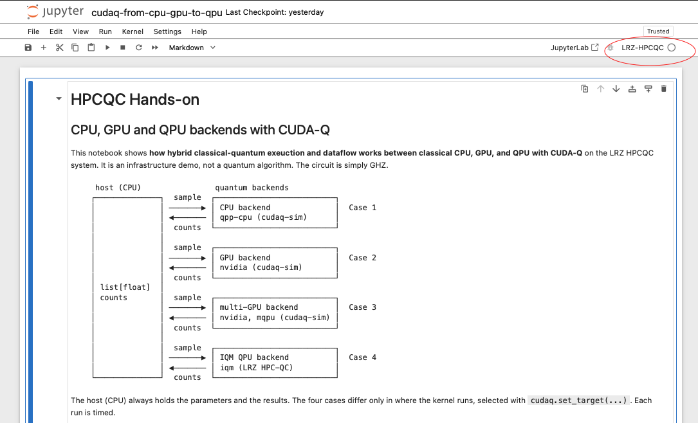
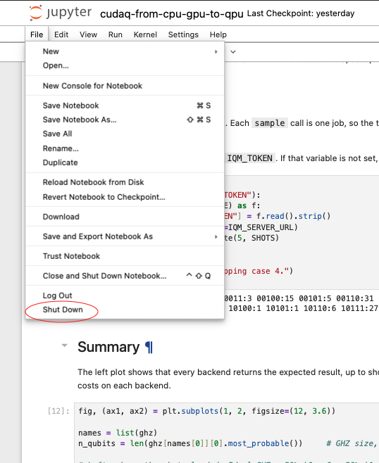

# Part I: HPCQC hands-on at LRZ

Play around with a sample CUDA-Q kernel (a GHZ state) that runs on a CPU, a GPU, multiple GPUs and an IQM quantum
computer at LRZ. The kernel is deliberately simple, so the focus stays on
the infrastructure: where the code runs and how data moves between CPU, GPU and QPU.

## Outline

1. **Introduction (slides, about 10 minutes):** the LRZ HPCQC infrastructure.
2. **Log in to the portal** and open the notebook ([below](#logging-in-to-the-portal)).
3. **Hands-on notebook** [`cudaq-from-cpu-gpu-to-qpu.ipynb`](cudaq-from-cpu-gpu-to-qpu.ipynb):

   | Case | Where the kernel runs | What it shows |
   |---|---|---|
   | 1. CPU only | `qpp-cpu` simulator | The baseline; fastest for small circuits |
   | 2. Single-GPU | `nvidia` simulator on a GPU slice | GPU simulation pays off as the qubit count grows (10, 15, 20 qubits) |
   | 3. Multi-GPU | `nvidia`, `option="mqpu"`, as a separate job on 4 GPUs | Many circuits in parallel (`sample_async`), and a Hamiltonian split over 4 MPI ranks |
   | 4. QPU | `iqm`, the IQM quantum computer | The same kernel on hardware: time is mostly network and queueing, results show hardware noise |
   | Summary | | Results and timing of all backends side by side |

   Only `cudaq.set_target(...)` changes between the cases; the host (CPU) always holds the input
   and the results.

## Logging in to the portal

You need a tutorial account (username and password, handed out at the session) or an LRZ account.

1. Open the portal: <https://vm-138-246-238-164.cloud.mwn.de>
2. Log in:
   - **Tutorial account:** enter your account email and password provided by us.
   - Please choose **Log in with Email**.
  
  

3. After logging in, the LRZ HPCQC dashboard (built on the open-source Open OnDemand) looks as follows:

  

  Then, click on **Jupyter Notebook**, set **Number of hours** to about 1 hour to cover this session and **Number of cores** to 1, then click **Launch**.

4. Wait until the session card shows **Running**, then click **Connect to Jupyter**. Jupyter opens
  in a new tab.

  

5. For the first session, please go to `sc26_quantum_tutorial/I_LRZ_HPCQC/` and open `cudaq-from-cpu-gpu-to-qpu.ipynb`.

  

Then, make sure the notebook uses the kernel named **LRZ-HPCQC**. Otherwise, change it by **Kernel → Change Kernel** and then restart the kernel.

7. Run the cells from top to bottom.

When you are done, use **File → Shut Down** (or shut down the kernel). That frees the GPU slice for others.

  

**Notes**:
- The next two sessions (Part II: SKQD, Part III: QEC) open their own notebooks and
  may start a new Jupyter server, so shut down this one before moving on.
- The LRZ-HPCQC kernel runs on an internal HPCQC cluster, not on the portal itself: plots are shown in the notebook, but the results are computed on the cluster.
- If the login page says "no state cookie", the login took too long: just try again.

## Files

| Path | Content |
|---|---|
| `cudaq-from-cpu-gpu-to-qpu.ipynb` | Hands-on notebook (4 cases and a summary) |
| `hpcqc-output/` | Plots written by the notebook |
| `slides/` | Slides for the introduction |

## System

- HPCQC testbed cluster at LRZ called Wolpertinger, used through the LRZ HPC-Quantum Computing Portal (Open OnDemand)
- NVIDIA A100 80 GB GPUs. Several nodes split their GPU into 7 MIG slices (`1g.10gb`), one slice
  per notebook kernel; a dedicated node for the multi-GPU example has 4 full A100s.
- IQM quantum computer Euro-Q-Exa System 1, codename EQE1 (`iqm_eqe1`)

## Other points

- Case 3 needs multiple GPUs. The `%%run_mgpu` cell magic (from
  `lrzqc-client`) submits the cell as a separate Slurm job to the dedicated node and returns at once, so
  continue with the next cases and collect the result afterwards.
- Today the GPU and the QPU exchange data only through the host, over the network. NVQLink is
  meant to connect them directly in the future.
- Shots and qubit counts are set in the notebook's **Setup** cell.

