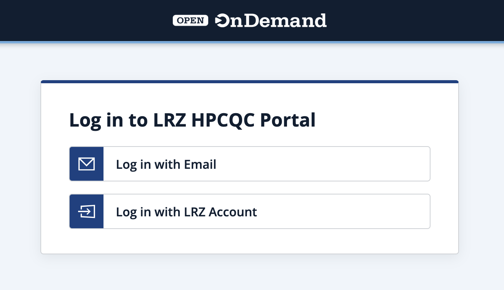
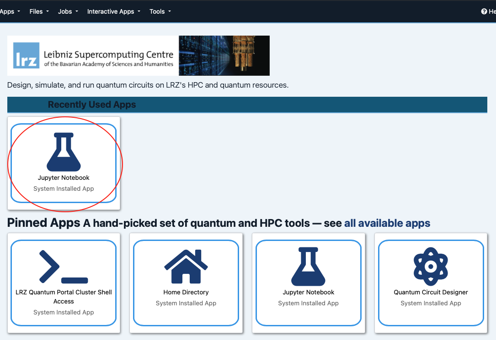
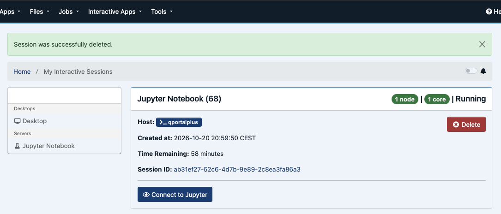
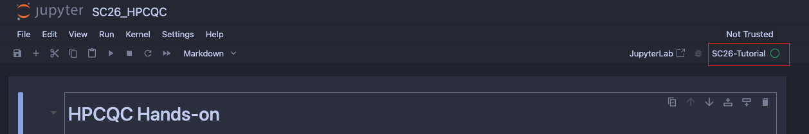

# Time and location

**SC26 tutorial:** [Accelerated Quantum Supercomputing: A Hands-On Tutorial on Quantum-Classical Hybrid Workflows Executed on QPUs and GPUs](https://sc26.conference-program.com/presentation/?id=tut185&sess=sess178)

- **When:** Sunday, 15 November 2026, 8:30am – 12:00pm CST
- **Where:** Room W185a
- **Presenters:** Michael Williams de la Bastida (UCL), Minh Chung (LRZ), Danny Bulmash (IQM), Zohim Chandani (NVIDIA)

# Abstract 

Accelerated quantum supercomputing (AQSC) requires engineers to consider the hardware, software, and infrastructure challenges that arise when integrating quantum processing units (QPUs) into an HPC environment.

This tutorial will provide attendees with hands-on experience to learn about AQSC infrastructure being deployed at supercomputing centers around the world. Participants will gain hands-on experience with the Python API of CUDA-Q. Attendees will have access to GPUs and IQM QPUs hosted at Leibniz Supercomputing Center (LRZ). Live demonstrations and hands-on exercises include how to scale workflows, from a simple pip install to deploying multi-GPU, multi-node, and QPU jobs. This will all be tied under two quantum algorithms: Sample-Based Krylov Quantum Diagonalization (SKQD: quantum & HPC) and Generative Quantum Eigensolver (GQE: AI & quantum), emphasizing the need for HPC and AI in quantum computing workflows.

Attendees will learn about challenges in scaling quantum hardware and advancements in quantum error mitigation (QEM) and quantum error correction (QEC) which address them. They will learn about and execute commonly used QEM and QEC techniques in superconducting devices and perform GPU-accelerated decoding of quantum measurements. Participants will leave with practical skills in building hybrid applications locally and experience in scaling them on AQSC infrastructure.

# Getting started

Run the hands-on notebooks on the **LRZ HPCQC portal** during the tutorial. **Google Colab** is a backup if you can't use the portal; it needs your own IQM Resonance account to create the valid token (which we also provide you).

| Part | Notebook | Colab |
|---|---|---|
| I – HPCQC at LRZ | [`I_LRZ_HPCQC/SC26_HPCQC.ipynb`](I_LRZ_HPCQC/SC26_HPCQC.ipynb) | [Open in Colab](https://colab.research.google.com/github/zohimchandani/sc26_quantum_tutorial/blob/main/I_LRZ_HPCQC/SC26_HPCQC.ipynb) |
| II – SKQD | [`II_SKQD/skqd_SOLUTIONS.ipynb`](II_SKQD/skqd_SOLUTIONS.ipynb) | [Open in Colab](https://colab.research.google.com/github/zohimchandani/sc26_quantum_tutorial/blob/main/II_SKQD/skqd_SOLUTIONS.ipynb) |
| III – QEC | [`III_QEC/SC26_QEC_SOLUTIONS.ipynb`](III_QEC/SC26_QEC_SOLUTIONS.ipynb) | [Open in Colab](https://colab.research.google.com/github/zohimchandani/sc26_quantum_tutorial/blob/main/III_QEC/SC26_QEC_SOLUTIONS.ipynb) |

## Option 1: LRZ HPCQC portal (recommended)

1. Open <https://hpcqctutorial.quantum.lrz.de>, choose **Log in with Email** and use the tutorial account
   (email and password) we hand out at the session.
2. On the dashboard, click **Jupyter Notebook**; by default, we set **Number of hours** in 4 hours,
   and **Number of cores** to 1. If this is not the case, please set it like that.
3. When the session card shows **Running**, click **Connect to Jupyter**.
4. Open the notebook of the current part in `sc26_quantum_tutorial/`. Check that the kernel (top right) is
   **SC26-Tutorial**; otherwise change it via **Kernel → Change Kernel**.
5. Note: Cells that start with `%%beast` run as jobs on LRZ's GPUs or the IQM
   QPU; the cell after each one waits for the job's output.

Shut down the kernel (**Kernel → Shut Down Kernel**) before you open the next part.
If the login page says "no state cookie", the login took too long: just log in again.

Screenshots

## Option 2: Google Colab (backup)

1. Click **Open in Colab** in the table above, then choose a GPU runtime
   (**Runtime → Change runtime type → T4 GPU**).
2. In the first code cell, replace `<YOUR_IQM_TOKEN>` with your IQM Resonance token and run the cell.
   It installs the packages, which takes a few minutes.
3. Note: the `%%beast` cells run right in Colab; the notebook itselft can skip these magic tags. Please just leave it like that, it does not affect the Colab runtime.

Don't save or share a notebook with your token in it. If a QPU cell fails with *No calibration data … at
('QBx', 'QBy')*, a qubit pair on the Resonance QPU is currently not calibrated: try again later.
